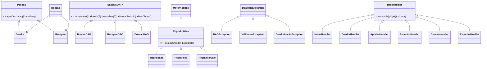
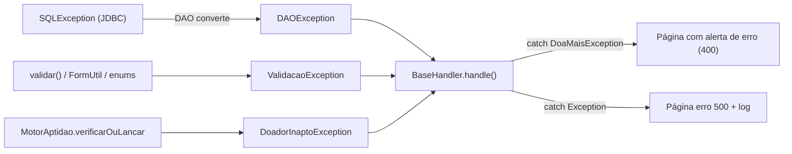

# Contratos do DoaMais

Este documento define **como os módulos conversam entre si**. As assinaturas já existem como **esqueletos compiláveis** em `src/`: cada método ainda não implementado lança `UnsupportedOperationException("TODO(<Nome>): ...")`.

> **Regra de ouro:** ninguém altera uma assinatura pública/protegida existente sem combinar com o grupo. O Javadoc de cada classe é a especificação detalhada; este arquivo é o mapa geral.

---

## 1. Pacotes e responsáveis

| Pacote | Arquivo | Responsável |
|---|---|---|
| `com.doamais` | `Main` | Maria Vitória |
| `db` | `Database` ✅ pronto, `CsvUtil` | Gabriel |
| `exception` | `DoaMaisException` ✅, `DAOException` ✅, `ValidacaoException` ✅ | Gabriel |
| `exception` | `DoadorInaptoException` ✅ | Guilherme |
| `model` | `Pessoa` ✅, `TipoSanguineo` ✅, `Sexo` ✅, `Doador` | Pedro |
| `model` | `Receptor`, `StatusCampanha` ✅ | Ricardo |
| `model` | `Doacao`, `NivelEstoque` ✅ | Amon |
| `dao` | `BaseDAO<T>` | Gabriel |
| `dao` | `DoadorDAO` | Pedro |
| `dao` | `ReceptorDAO` | Ricardo |
| `dao` | `DoacaoDAO`, `EstoqueDAO` | Amon |
| `service` | `RegraAptidao` ✅, `ResultadoAptidao` ✅, `MotorAptidao`, *(criar)* `RegraIdade`, `RegraPeso`, `RegraIntervalo` | Guilherme |
| `service` | `DoacaoService` | Amon |
| `handler` | `BaseHandler`, `HomeHandler` | Maria Vitória |
| `handler` | `DoadorHandler` | Pedro |
| `handler` | `AptidaoHandler` | Guilherme |
| `handler` | `ReceptorHandler` | Ricardo |
| `handler` | `DoacaoHandler` | Amon |
| `handler` | `ExportarHandler` | Gabriel |
| `util` | `FormUtil`, `HtmlUtil` | Maria Vitória |
| `teste` | `DatabaseTeste` ✅ + um teste por integrante | cada um |
| `web/` | `style.css`, `app.js` | Maria Vitória |
| `dados/seed/` | `doadores.csv`, `receptores.csv`, `doacoes.csv` | Gabriel |

✅ = contrato já completo (só ajustar Javadoc/explicar na apresentação).

---

## 2. Diagrama de classes (núcleo de POO)

---

## 3. Banco de dados (SQLite, `database/doamais.db`)

Criado automaticamente por `Database.inicializar()`. **Só o Gabriel altera o schema.**

| Tabela | Colunas |
|---|---|
| `doadores` | `id` PK · `nome` · `cpf` UNIQUE · `data_nascimento` · `sexo` (`'M'`/`'F'`) · `peso` REAL · `tipo_sanguineo` · `telefone` · `email` · `data_ultima_doacao` (NULL = nunca doou) |
| `receptores` | `id` PK · `nome_paciente` · `hospital` · `historia` · `tipo_sanguineo` · `meta_doacoes` · `doacoes_recebidas` · `status` (`'ATIVA'`/`'CONCLUIDA'`) · `data_criacao` |
| `doacoes` | `id` PK · `doador_id` FK → doadores · `receptor_id` FK → receptores (NULL = estoque geral) · `data_doacao` · `local` |
| `estoque_hemoes` | `tipo_sanguineo` PK · `nivel` (`'CRITICO'`/`'BAIXO'`/`'NORMAL'`/`'ALTO'`) · `atualizado_em` |

**Conversão Java ↔ banco** (os DAOs fazem; os helpers da `BaseDAO` recebem valores já convertidos):

| Java | Banco (TEXT) | Ida | Volta |
|---|---|---|---|
| `LocalDate` | `"2026-11-23"` | `data.toString()` | `LocalDate.parse(s)` (checar `null`) |
| `TipoSanguineo` | `"O-"` | `tipo.getRotulo()` | `TipoSanguineo.deRotulo(s)` |
| `Sexo` | `"M"` | `sexo.getCodigo()` | `Sexo.deCodigo(s)` |
| `StatusCampanha` / `NivelEstoque` | `"ATIVA"` | `x.name()` | `StatusCampanha.valueOf(s)` |

Conexão: sempre `try (Connection c = Database.getConnection(); PreparedStatement ps = ...) { }`.

---

## 4. Rotas (registradas em `Main`, já prontas)

| Prefixo | Handler | Caminhos atendidos |
|---|---|---|
| `/` | `HomeHandler` (Maria) | `/` → termômetro + feed. Outros caminhos → 404 |
| `/doadores` | `DoadorHandler` (Pedro) | `GET /doadores[?tipo=O-]` · `GET/POST /doadores/novo` · `GET /doadores/editar?id=` · `POST /doadores/editar` |
| `/aptidao` | `AptidaoHandler` (Guilherme) | `GET /aptidao[?doadorId=]` · `POST /aptidao` |
| `/campanhas` | `ReceptorHandler` (Ricardo) | `GET/POST /campanhas/nova` · `GET /campanhas/ver?id=` |
| `/doacoes` | `DoacaoHandler` (Amon) | `GET /doacoes` · `GET /doacoes/nova[?receptorId=]` · `POST /doacoes/nova` |
| `/exportar` | `ExportarHandler` (Gabriel) | `GET /exportar` · `GET /exportar?tabela=doadores` |
| `/static/` | (Maria, no `Main`) | `/static/style.css`, `/static/app.js` (pasta `web/`) |

Depois de um POST bem-sucedido: `redirecionar(ex, ...)` (padrão Post/Redirect/Get).

### Nomes dos campos dos formulários (`name=`)

| Formulário | Campos |
|---|---|
| Doador | `id` (oculto, na edição) · `nome` · `cpf` · `dataNascimento` · `sexo` (`M`/`F`) · `peso` · `tipoSanguineo` (`A+`…) · `telefone` · `email` · `dataUltimaDoacao` |
| Pré-triagem | `dataNascimento` · `sexo` · `peso` · `dataUltimaDoacao` |
| Campanha | `nomePaciente` · `hospital` · `tipoSanguineo` · `metaDoacoes` · `historia` |
| Doação | `doadorId` · `receptorId` (vazio = estoque geral) · `dataDoacao` · `local` |

Datas usam `<input type="date">` (formato `yyyy-MM-dd`), lidas com `FormUtil.getData`.

---

## 5. Fluxo de erros (tratamento de exceção)

Todas as exceções próprias herdam de `DoaMaisException` (checked). Os services e DAOs **não** escondem erros: eles sobem até o `BaseHandler`.

---

## 6. Ordem recomendada

O código compila desde o início, então **todos podem trabalhar em paralelo**. Mas, em tempo de execução, as partes dependem umas das outras:

1. **Gabriel** (`BaseDAO`) e **Maria Vitória** (`BaseHandler`, `FormUtil`, `HtmlUtil`) devem subir primeiro: sem eles nenhum DAO ou tela funciona de verdade.
2. **Pedro**, **Ricardo** e **Guilherme** em seguida.
3. **Amon** integra tudo no `DoacaoService` (depende dos três acima).

Enquanto a parte de um colega não estiver na `main`, os testes que a usam vão lançar `UnsupportedOperationException: TODO(<Colega>)`. Isso é normal.

---

## 7. Cenário da demonstração (todos devem garantir que funcione)

1. Home mostra o termômetro do HEMOES com **O-** e **B-** em nível **crítico**.
2. Feed mostra a campanha da **Maria Clara, 8 anos, Hospital Estadual Infantil**, tipo O+, **3 de 5 bolsas (60%)**.
3. Pré-triagem/registro de doação para um **homem que doou há 25 dias** → bloqueado, com a data de liberação.
4. Registro de doação de um doador apto para a Maria Clara → barra vai para **4/5 (80%)**.

Os dados vêm de `dados/seed/*.csv` (Gabriel). A apresentação é em **23/11/2026**: o doador "doou há 25 dias" deve ter `data_ultima_doacao = 2026-10-29`.
